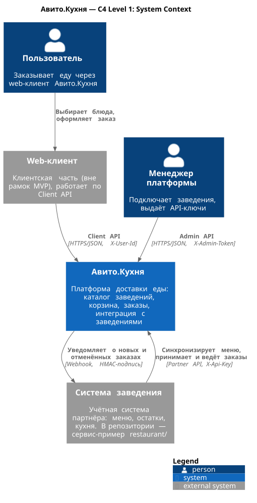
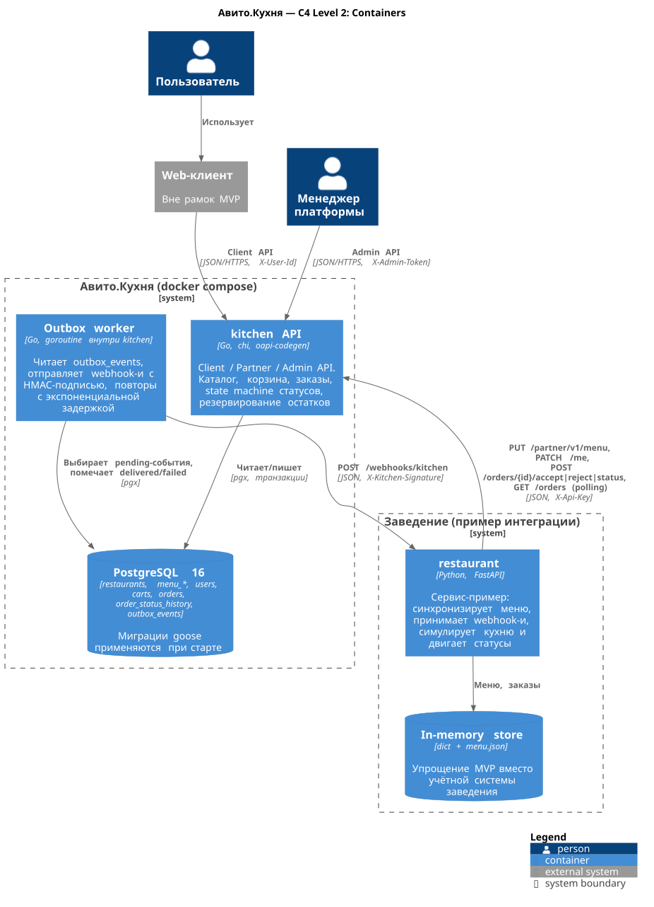
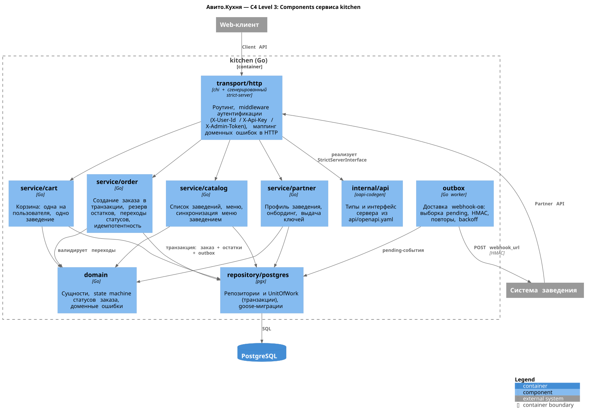
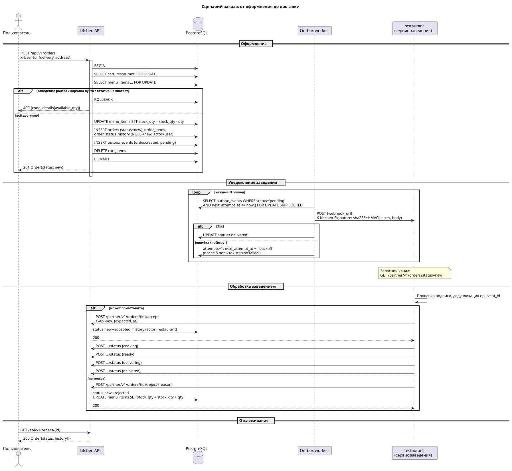
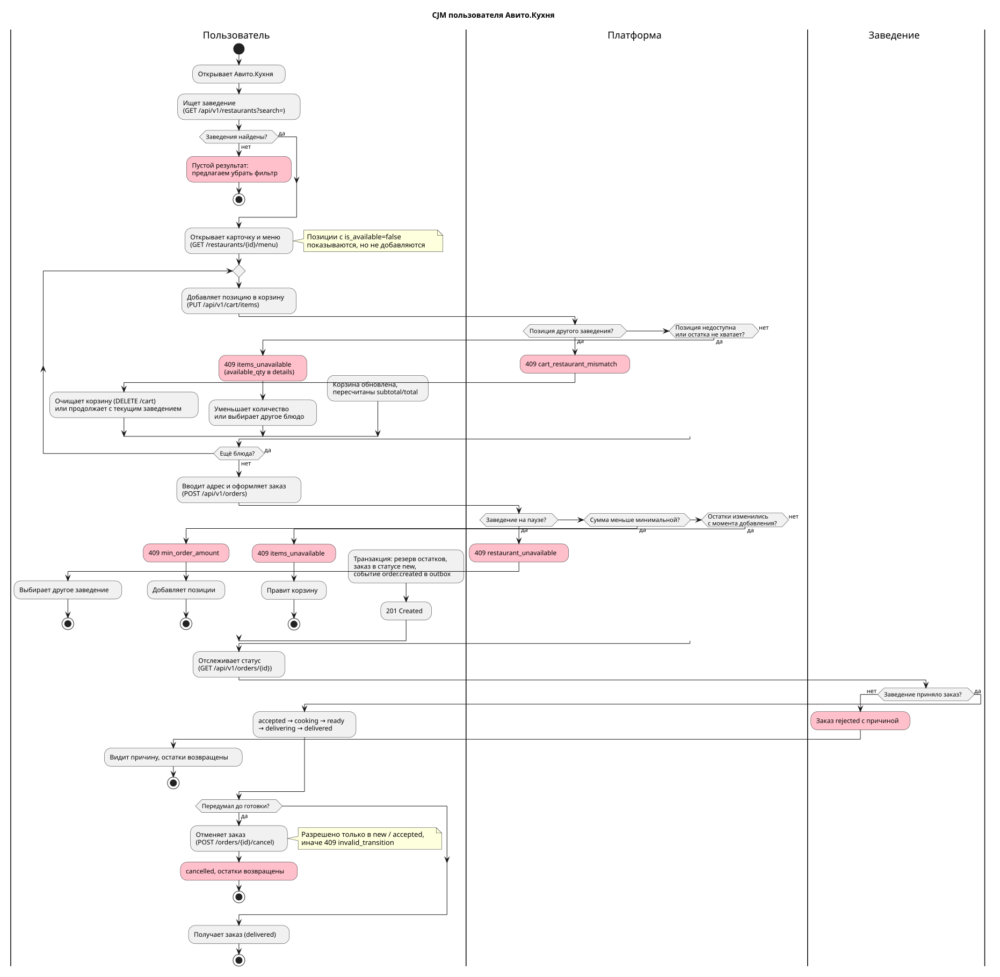
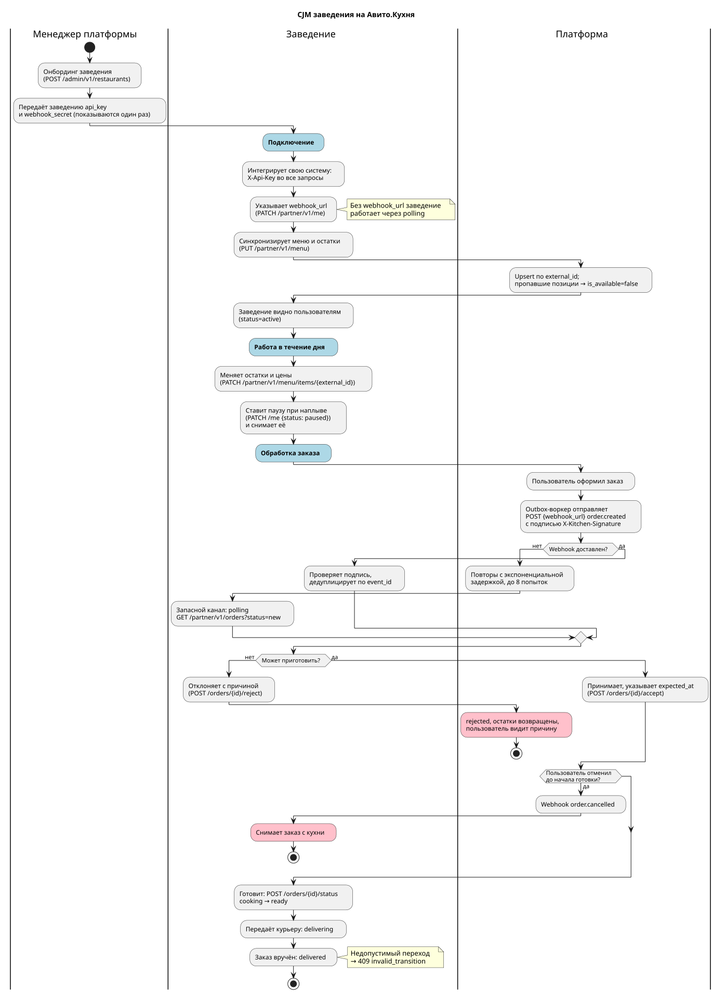
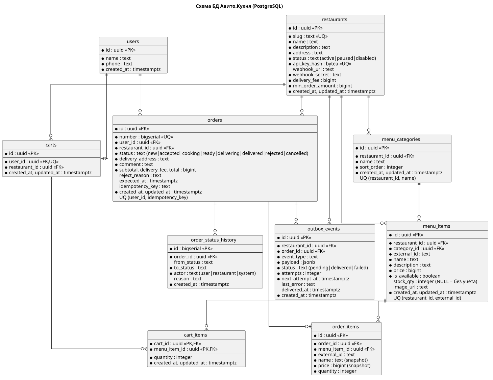

# Авито.Кухня

> Исходная формулировка в [backend-trainee-assignment-autumn-2026.md](backend-trainee-assignment-autumn-2026.md), план реализации (prompt для ИИ-агента) в [PLAN.md](PLAN.md)

Платформа доставки еды, состоящая из двух сервисов:

| Сервис | Директория | Стек | Назначение |
|---|---|---|---|
| **kitchen** | `cmd/`, `internal/` | Go, chi, pgx, PostgreSQL | Основной API: клиентский *(web)*, партнёрский *(заведения)*, административный |
| **restaurant** | `restaurant/` | Python, FastAPI | Пример заведения, интегрированного с платформой через API и webhook-и |

Взаимодействие двустороннее: заведение обращается к партнёрскому API для синхронизации меню и ведения заказов, платформа уведомляет заведение о событиях заказа через webhook.

## Запуск

```bash
docker compose up --build
```

или 

```bash
make up
```

| Сервис | Адрес |
|---|---|
| kitchen | http://localhost:8080/health |
| restaurant | http://localhost:8090/health |
| postgres | localhost:5432 |

Сервис `restaurant` запускается после healthcheck платформы, регистрирует адрес webhook-а и загружает меню из [`restaurant/data/menu.json`](restaurant/data/menu.json).

Сквозная проверка всех сценариев против стека *(37 проверок)*:

```bash
make e2e
```

или

```bash
scripts/e2e.sh
```

Пример оформления заказа через API:

```bash
USER=11111111-1111-1111-1111-111111111111
REST=aaaaaaaa-aaaa-aaaa-aaaa-aaaaaaaaaaaa

# каталог и меню
curl -s -H "X-User-Id: $USER" localhost:8080/api/v1/restaurants
curl -s -H "X-User-Id: $USER" localhost:8080/api/v1/restaurants/$REST/menu

# корзина и заказ
curl -s -X PUT -H "X-User-Id: $USER" -H 'Content-Type: application/json' \
  -d '{"menu_item_id":"<id>","quantity":2}' localhost:8080/api/v1/cart/items
curl -s -X POST -H "X-User-Id: $USER" -H 'Content-Type: application/json' \
  -d '{"delivery_address":"Москва, ул. Примерная, 10"}' localhost:8080/api/v1/orders

curl -s -H "X-User-Id: $USER" localhost:8080/api/v1/orders/<order_id>
```

## Архитектура

### Контекст

Участники системы: пользователь через web-клиент, заведение через партнёрский API, менеджер платформы через административный API.



### Контейнеры

`kitchen` предоставляет три группы API и содержит фоновый воркер доставки webhook-ов, состояние хранится в PostgreSQL. `restaurant` реализован на другом языке и подключается к платформе через тот же партнёрский API, что и учётная система реального заведения.



### Компоненты kitchen

Слои идут сверху вниз, каждый зависит только от следующего:

| Слой | Пакет | Ответственность |
|---|---|---|
| Транспорт | `internal/transport/http` | Роутер chi поверх сгенерированного из OpenAPI интерфейса, аутентификация трёх типов, маппинг доменных ошибок в единый формат |
| Сценарии | `internal/service/*` | Каталог, корзина, заказы, партнёрские операции и онбординг |
| Домен | `internal/domain` | Сущности, машина состояний заказа, правила доступности позиций, подпись webhook-ов |
| Данные | `internal/repository/postgres` | Репозитории на pgx, транзакции, миграции goose |
| Доставка событий | `internal/outbox` | Воркер: выборка событий, подпись, повторы |



### Ключевые решения

**Заказ создаётся одной транзакцией.** Внутри неё блокируются заведение и позиции меню, проверяются доступность и минимальная сумма, списываются остатки, пишутся заказ, история и событие для заведения, очищается корзина. Параллельные заказы одной позиции сериализуются блокировкой, двойное списание остатка исключено.

**Позиции блокируются в порядке возрастания идентификатора.** Единый порядок исключает взаимную блокировку параллельных заказов, которые пересекаются по позициям.

**Переходы статусов описаны машиной состояний.** У каждого перехода ровно один допустимый инициатор: заведение ведёт заказ по цепочке, пользователь может только отменить его до начала готовки. Недопустимый переход возвращает `409 invalid_transition`.

**Уведомления доставляются через transactional outbox.** Событие пишется в ту же транзакцию, что и заказ, фоновый воркер доставляет его отдельно: подписывает тело HMAC-SHA256, повторяет по возрастающему расписанию от секунды до десяти минут, после восьми попыток помечает `failed`.

**Позиции меню адресуются по `external_id`.** Платформа хранит собственные UUID, в webhook-ах и партнёрском API передаются идентификаторы заведения. Внутренние ключи двух систем не связаны.

**Позиции меню не удаляются.** Пропавшие из синхронизации помечаются `is_available=false`.

Последовательность оформления заказа и цикла доставки события:



## Сценарии

### Пользователь

Полная карта с ветками ошибок: [`docs/diagrams/cjm-user.svg`](docs/diagrams/cjm-user.svg)



Основной путь:
  1. Поиск заведения
  2. Меню
  3. Корзина
  4. Оформление
  5. Отслеживание до доставки. 
  
#### Продуманные ситуации

| Ситуация | Поведение системы |
|---|---|
| Блюдо закончилось | Позиция видна в меню с `is_available=false`, добавление в корзину даёт `409` с доступным количеством |
| Остаток изменился, пока корзина лежала | Проверка повторяется при оформлении, ответ `409 items_unavailable` со списком позиций |
| Позиция другого заведения | `409 cart_restaurant_mismatch`, корзину требуется очистить явно |
| Заведение приостановило приём | Видно в каталоге со статусом `paused`, оформление даёт `409 restaurant_unavailable` |
| Сумма меньше минимальной | `409 min_order_amount` с указанием минимума и суммы корзины |
| Отмена заказа | Разрешена в статусах `new` и `accepted`, в последующих возвращается `409` |
| Заведение отказало | Заказ переходит в `rejected` с причиной, остатки возвращаются |
| Повторная отправка формы | Заголовок `Idempotency-Key` возвращает уже созданный заказ вместо дубля |

### Заведение

Полная карта: [`docs/diagrams/cjm-restaurant.svg`](docs/diagrams/cjm-restaurant.svg)



Основной путь:
  1. Онбординг
  2. Настройка webhook
  3. Синхронизация меню
  4. Приём заказов
  5. Готовка и доставка

#### Продуманные ситуации

| Ситуация | Поведение системы |
|---|---|
| Webhook не доставлен | Повторы с растущей задержкой, запасной канал `GET /partner/v1/orders?status=new` |
| Повторная доставка события | В теле есть `event_id`, заведение дедуплицирует и не готовит заказ дважды |
| Нет webhook-адреса | События не создаются, заведение работает опросом |
| Наплыв заказов | `PATCH /partner/v1/me {"status":"paused"}`, платформа перестаёт принимать заказы |
| Блюдо закончилось на кухне | `PATCH /partner/v1/menu/items/{external_id}` меняет остаток, платформа сразу перестаёт его продавать |
| Остатки платформы и заведения разошлись | Заведение отклоняет заказ с причиной, остатки возвращаются пользователю |
| Позиция ушла из меню | Полная синхронизация помечает её недоступной, старые заказы остаются целыми |

## API

Спецификация: [`api/openapi.yaml`](api/openapi.yaml). Из неё генерируется серверный интерфейс (`make generate`).

| Группа | Префикс | Аутентификация | Состав |
|---|---|---|---|
| Клиентский | `/api/v1` | `X-User-Id` | Каталог, меню, корзина, заказы, отмена |
| Партнёрский | `/partner/v1` | `X-Api-Key` | Профиль, синхронизация меню, остатки, заказы, принятие, отказ, статусы |
| Административный | `/admin/v1` | `X-Admin-Token` | Онбординг заведения с выдачей ключа и секрета |

Ошибки возвращаются в едином формате `{code, message, details[]}`. В `details` передаются проблемное поле или конкретная позиция меню с запрошенным и доступным количеством.

Уведомление заведения о событии заказа: `POST {webhook_url}` с телом `WebhookEvent` и заголовком `X-Kitchen-Signature: sha256=<HMAC-SHA256(webhook_secret, body)>`.

## База данных

Подробное описание: [`docs/db.md`](docs/db.md). ER-диаграмма:



Десять таблиц в трёх группах: заведения с меню, пользователи с корзинами, заказы с историей статусов и очередью событий. Сквозные соглашения: деньги целыми числами в копейках, идентификаторы UUID, время `timestamptz`, статусы текстом с `CHECK`, снимки названий и цен в заказах.

Миграции goose находятся в [`migrations/`](migrations), встраиваются в бинарник и применяются при старте сервиса.

## Разработка

```bash
make help        # список целей
make lint        # golangci-lint + ruff + mypy
make test        # go test -race + pytest
make generate    # кодогенерация сервера из api/openapi.yaml
make diagrams    # рендер PlantUML в SVG
make up          # поднять стек
make down        # остановить стек
make e2e         # сквозная проверка сценариев
make py-venv     # .venv для сервиса заведения
```

Конфигурация линтеров в репозитории: [`.golangci.yml`](.golangci.yml) для Go, секции `[tool.ruff]` и `[tool.mypy]` в [`restaurant/pyproject.toml`](restaurant/pyproject.toml) для Python. mypy работает в режиме `strict`.

Тесты покрывают машину состояний и правила домена, сценарные сервисы на стабах репозиториев, воркер доставки на тестовом HTTP-сервере, обработчик webhook-ов и симулятор кухни на стороне заведения.

Конфигурация обоих сервисов задаётся переменными окружения, пример в [`.env.example`](.env.example).

## Упрощения MVP

**Административный доступ по статическому токену.** `X-Admin-Token` сравнивается со значением из конфигурации. 

**Демо-заведение с фиксированным ключом в seed-миграции.** Ключ `demo-restaurant-key` и секрет `demo-webhook-secret` заданы явно, чтобы сервис-пример поднимался без ручных шагов.

**У сервиса-заведения хранилище в памяти.** Роль учётной системы заведения выполняет словарь: данные не переживают перезапуск, меню читается из JSON.

**Оплата не реализована.** Заказ переходит в работу сразу после оформления.

**Доставка условная.** Курьеров и их назначения нет, статусы `delivering` и `delivered` выставляет заведение.

**Один экземпляр воркера в процессе API.** Выборка событий использует `FOR UPDATE SKIP LOCKED` и аренду, поэтому несколько экземпляров корректны, но горизонтальное масштабирование не проверялось. При росте нагрузки outbox заменяется на брокер сообщений без изменения сервисов.

**Наблюдаемость ограничена структурными логами.** Нет метрик, трассировки и алертов на события со статусом `failed`.

**Тесты покрывают домен и сценарии, но не репозитории.** Слой данных проверяется сквозным скриптом на живой БД.
